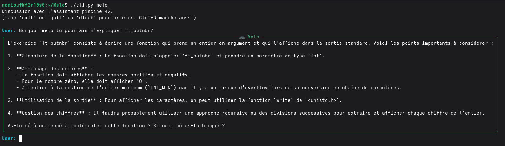
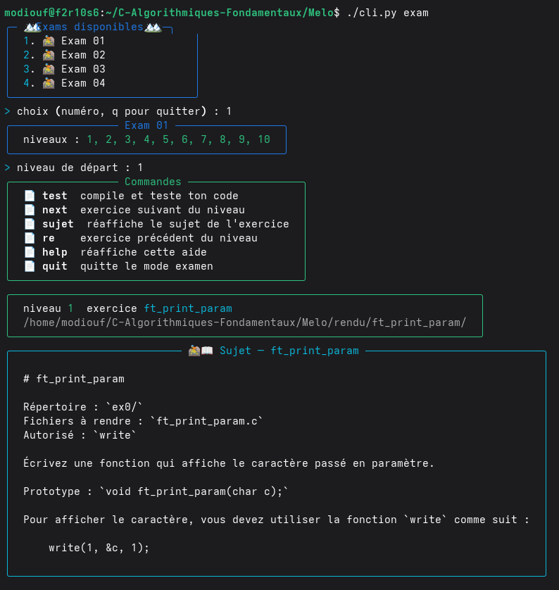
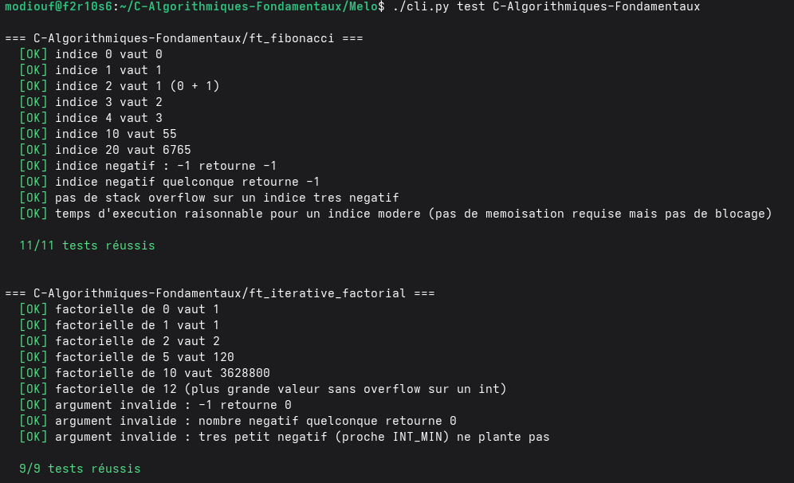

# Simulateur de piscine Melo

Simulateur maison pour la Piscine 42.

`Melo` permet de tester ses exercices avant la Moulinette, de simuler un examen, de vérifier des modules entiers et d'obtenir de l'aide grâce à un assistant IA.

## Features

* 🤖 **Assistant IA** — Melo explique les sujets et répond aux questions sur les exercices.
* 📝 **Exam Simulator** — Simule les conditions d'un examen avec une progression par niveaux.
* 🧪 **Moulinette Simulator** — Permet de tester plusieurs exercices d'un même module.

---

# ⚙️ Installation

Clone le projet puis installe les dépendances :

```bash
git clone <URL_DU_REPO>
cd Melo
pip install -r requirements.txt
```

Pour utiliser l'Assistant IA :

```bash
export OPENAI_API_KEY=sk-...
```


# 🤖 Assistant IA




**Melo** est un chatbot qui fonctionne via des appels API directement depuis le terminal.

Elle n'a **pas accès directement aux fichiers de ton projet**.

À la place, Melo dispose d'un outil appelé `get_exercise_subject`.

Lorsque tu lui demandes d'expliquer un exercice :

1. Melo identifie le nom de l'exercice.
2. Elle appelle `get_exercise_subject`.
3. Le programme recherche le `README.md` correspondant dans `exercises/`.
4. Le contenu du sujet est envoyé à l'IA.
5. Melo lit le sujet et te l'explique avec ses propres mots.
6. Elle ne fournit jamais le code de la solution.

Cela permet à Melo de connaître uniquement le sujet dont tu lui demandes l'explication, plutôt que d'avoir accès directement à tous les fichiers du projet.

### Lancer l'Assistant IA

```bash
./cli.py melo
```

Pour utiliser l'API OpenAI, configure ta clé :

```bash
export OPENAI_API_KEY=sk-...
```


# 📝 Exam Simulator




Le mode `exam` permet de simuler une session d'examen avec une progression par niveaux.

### Lancer un examen

```bash
./cli.py exam
```

Le programme recherche les exercices dans :

```text
exercises_exam/
```

Chaque exercice possède son propre dossier contenant :

```text
exercises_exam/
└── ft_xxx/
    ├── README.md
    └── manifest.yaml
```

### README.md

Le `README.md` contient le **sujet de l'exercice**.

Il est affiché lorsque tu arrives sur l'exercice et sert uniquement à t'expliquer ce que tu dois coder.

Le `README.md` n'est **pas utilisé pour vérifier ton code**.

### manifest.yaml

Le `manifest.yaml` contient les **vrais tests** de l'exercice.

Chaque test :

1. compile ton code avec un petit programme `main`,
2. exécute le programme,
3. récupère sa sortie réelle,
4. compare cette sortie avec `expected_stdout`,
5. vérifie également `expected_exit`.

Exemple de fonctionnement :

```text
Ton code
   ↓
Compilation avec le main du test
   ↓
Exécution
   ↓
stdout / exit code
   ↓
Comparaison avec expected_stdout / expected_exit
   ↓
PASS / FAIL
```

### README vs manifest

Ces deux fichiers ont donc des rôles différents :

```text
README.md
    ↓
Explique quoi coder

manifest.yaml
    ↓
Vérifie si ton code fonctionne correctement
```

Il n'y a **aucune comparaison entre le README et le manifest**.

Le mode exam :

* choisit un exercice par niveau depuis `exams/*.yaml`,
* affiche son `README.md`,
* crée le fichier `.c` dans `rendu/`,
* attend que tu codes,
* puis lance les tests du `manifest.yaml` lorsque tu utilises `test`.


# 🧪 Moulinette Simulator



Le mode `test` permet de vérifier directement ton rendu avec les mêmes principes de tests que le mode exam.

### Lancer un test

```bash
./cli.py test (détecte automatiquement le module à tester)
./cli.py test ft_putnbr (pour tester un seul exo)
./cli.py test nom_du_module (pour tester tout le module d'un coup)
```

Le programme recherche l'exercice dans :

```text
exercises/
```

⚠️ Ce dossier est différent de `exercises_exam/`, utilisé par le mode exam.

Il récupère ensuite le `manifest.yaml` de l'exercice.

Pour chaque test, le programme :

1. compile ton code avec le `main` du test,
2. exécute le programme,
3. récupère la sortie réelle,
4. compare avec `expected_stdout`,
5. vérifie `expected_exit`,
6. indique si le test passe ou échoue.


# 📚 Common Core : Libft

Le mode `test` sait aussi tester une **libft complète** (sujet v1.3) : les 43 fonctions et toutes les règles du sujet.

### Lancer les tests

```bash
./cli.py test libft ~/chemin/vers/libft             # tout
./cli.py test libft/ft_split ~/chemin/vers/libft    # une seule fonction
./cli.py test libft/makefile ~/chemin/vers/libft    # une seule section
./cli.py list                                       # toutes les cibles possibles
./cli.py test libft ~/chemin/vers/libft --strict    # + vérifications plus sévères que la moulinette
```

Sans chemin, Melo teste son dossier parent : si Melo est cloné dans ta libft, `./cli.py test libft` suffit.

Par défaut, Melo teste comme la moulinette.
`--strict` ajoute des vérifications qu'elle ne fait pas mais qu'un correcteur peut demander :
échecs de malloc simulés, helpers en `static`, `make re`.

### Ce qui est testé

| Section | Vérifications |
|---------|---------------|
| `rendu` | fichiers obligatoires, tout à la racine, aucun fichier en trop, chaque `.c` compile avec `-Wall -Wextra -Werror`, pas de `restrict` |
| `makefile` | `make` crée `libft.a`, règles `$(NAME) all clean fclean re`, `cc` + flags, `ar` (pas `libtool`), pas de relink, aucun `.c` inutilisé, `clean`, `fclean` (+ `re` en `--strict`) |
| `header` | `libft.h` compile seul, protégé contre la double inclusion, `t_list` conforme, prototypes exacts du sujet |
| `symboles` | toutes les fonctions présentes, pas de variable globale, helpers en `static` (`--strict`), seules les fonctions externes autorisées par le sujet (`nm`) |
| `norme` | `norminette` sur tous les `.c` et `.h` (ignoré si non installée) |
| `readme` | première ligne en italique, sections Description / Instructions / Resources, usage de l'IA décrit |
| `ft_*` | comportement de chaque fonction comparé au sujet ou à la vraie libc, cas limites, fuites et erreurs mémoire (valgrind), **échecs de malloc simulés** en `--strict` (la fonction doit renvoyer NULL sans fuite) |

### Vérification du README de la libft

| Règle du sujet | Ce que Melo vérifie |
|----------------|---------------------|
| `README.md` à la racine | le fichier existe |
| Première ligne en italique | exactement `*This activity has been created as part of the 42 curriculum by <login1>[, <login2>...]*` (ou `_..._`, pas en gras) |
| Section Description | un titre `#` contenant « Description » |
| Section Instructions | un titre `#` contenant « Instructions » |
| Section Resources | un titre `#` contenant « Resources » (ou « Ressources ») |
| Usage de l'IA décrit dans Resources | une mention de l'IA (AI, IA, ChatGPT, LLM...) dans Resources ou ses sous-sections |

Non vérifié (à relire toi-même) : le contenu des sections, la description détaillée de la librairie, les références de Resources et le détail des tâches où l'IA a servi.

Le Makefile est testé sur une copie : ton dossier n'est jamais modifié.
Les fonctions sont testées avec une lib compilée par Melo, donc un Makefile cassé n'empêche pas de tester les fonctions.

⚠️ La simulation d'échec de malloc utilise `ld --wrap` : Linux uniquement.

### Où sont les tests

```text
projects/libft/project.yaml        # prototypes, fonctions autorisées, fichiers attendus
projects/libft/includes/           # helpers C des tests (melo.h, melo_malloc.h)
projects/libft/part1|2|3/ft_*/manifest.yaml
```
