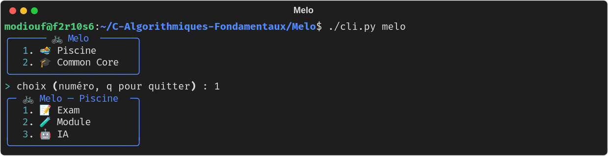
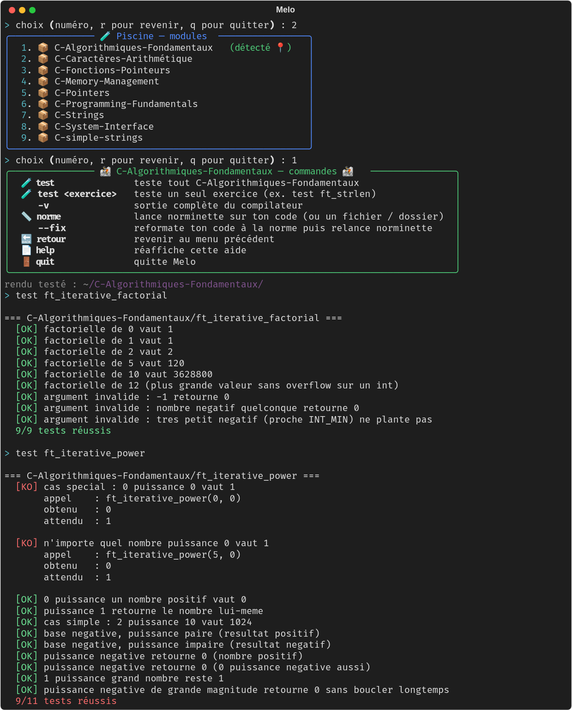
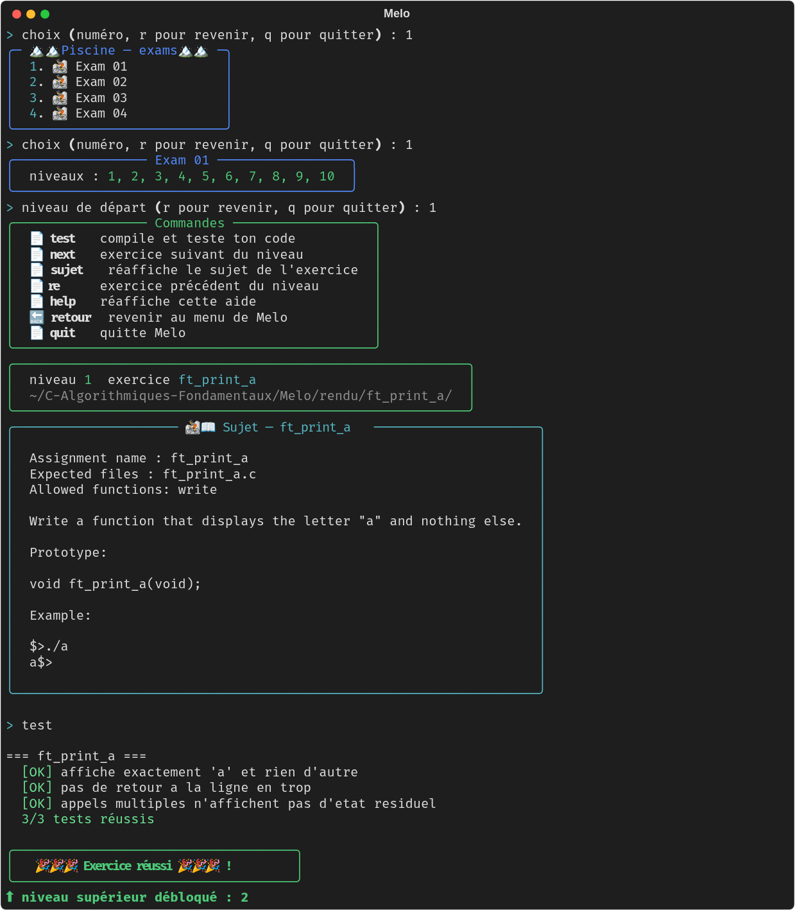
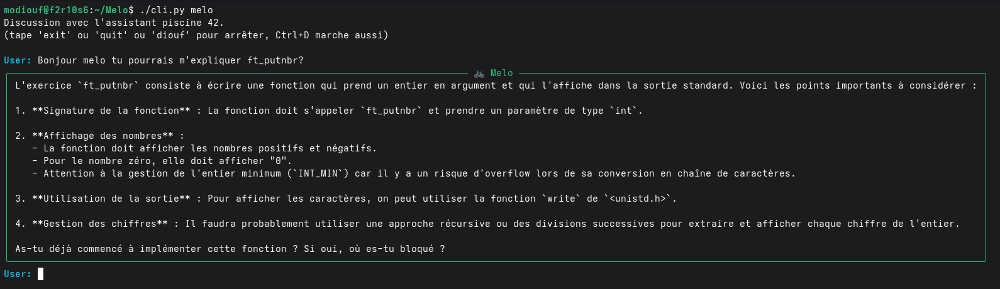

# 🚲 Melo

Melo est un simulateur maison pour la **Piscine** et le **Common Core** de 42.

Le but : tester ton code **avant la Moulinette**, t'entraîner aux **examens** dans des conditions proches du réel, et avoir un **assistant IA** qui t'explique les sujets sans jamais te donner la solution.

* 🧪 **Moulinette** — teste tes exercices et tes projets (libft, ft_printf, get_next_line, push_swap) et te dit exactement ce qui ne va pas.
* 📝 **Exam** — simule un examen avec une progression par niveaux.
* 🤖 **Assistant IA** — t'explique un sujet et répond à tes questions.



---

## ⚙️ Installation

Clone Melo **dans le dossier de ton module** (ta libft, ton dossier de piscine...) : Melo teste toujours son dossier parent.

```bash
cd ~/libft
git clone https://github.com/Bielorretto/Melo.git Melo
cd Melo
pip install -r requirements.txt
./cli.py melo
```

Tout se fait ensuite dans le menu, en tapant juste un numéro. `r` revient en arrière, `q` quitte, `help` affiche les commandes.

Pour l'assistant IA : `export OPENAI_API_KEY=sk-...`

---

## 🧪 Moulinette



## 📝 Exam



## 🤖 Assistant IA



---

## 📊 Statistiques

À chaque lancement, Melo envoie **ton login (`$USER`) et la date** pour compter le nombre d'utilisateurs. Rien d'autre n'est envoyé (ni ton code, ni tes fichiers).
Pour le désactiver : `export MELO_NO_STATS=1`.
